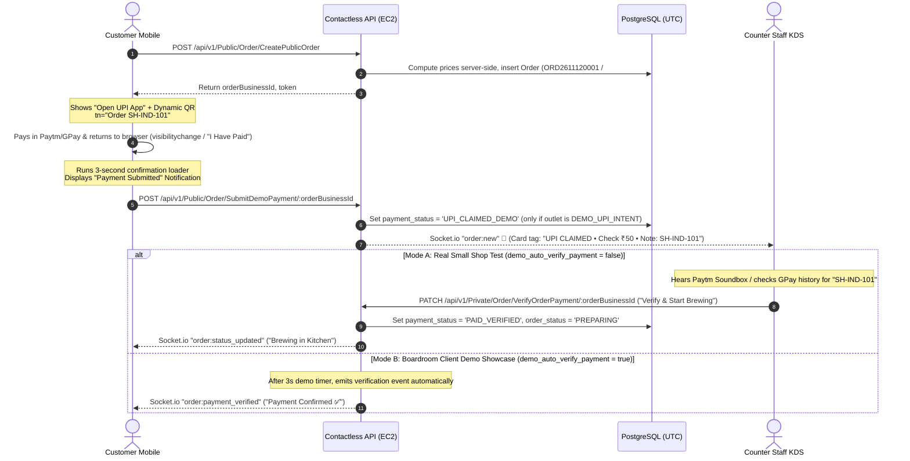

# 04 — Demo UPI Pilot Flow & Production Payment Upgrade Architecture

---

## 1. Why This Architecture Exists
Before onboarding Razorpay or Cashfree KYC for production, the client is testing the contactless ordering flow at a real small-shop counter using their Paytm UPI QR.

### Pilot Shop UPI Details (From Client's Counter QR)
- **Payee Name (`pn`)**: `MUNISWAMY JOSHVA`
- **UPI ID (`pa`)**: `paytm.s211ne7@pty`

### Real-World Technical Constraint to Respect
- A raw `upi://pay` link **does not** trigger an automated bank webhook back to our server.
- On some Android phones, **Google Pay / PhonePe** can block or warn on browser `upi://pay` intents directed to non-PG-signed `@pty` VPAs, whereas **scanning a Dynamic QR Code** works reliably across GPay, PhonePe, Paytm, and desktop testing.
- Therefore, the Demo checkout provides **both** an **"Open UPI App"** button and a **Dynamic Scannable QR Code** generated from the exact same server-computed URI.

---

## 2. End-to-End Demo Flow (With 3-Second Notification & Counter Verification)



### Dynamic UPI URI Specification
Generated strictly by the backend from server-calculated totals (never trust client price):
```text
upi://pay?pa=paytm.s211ne7@pty&pn=MUNISWAMY%20JOSHVA&am=50.00&cu=INR&tn=Order%20SH-IND-101&tr=SHIND101
```
- The `tn` parameter ensures **`Order SH-IND-101`** appears inside the customer's and shopkeeper's GPay/Paytm transaction history for 1-second visual/soundbox matching at the counter.

---

## 3. Security Rules for Payment States
- **Never allow frontend to set `PAID_VERIFIED`**.
- Keep statuses strictly separated:
  - `PAYMENT_PENDING`: Order created, awaiting payment.
  - `UPI_CLAIMED_DEMO`: Only allowed when outlet `payment_provider === 'DEMO_UPI_INTENT'`. Displays Counter Verification Pass on customer phone until staff approves.
  - `PAID_VERIFIED`: Only set by authenticated Counter Staff (`MD` / `OUTLET_STAFF`) in Demo mode, **OR** by a cryptographically verified HMAC Webhook from Razorpay/Cashfree in Production mode.

---

## 4. Zero-Rewrite Upgrade to Production (Razorpay / Cashfree)

Using a `PaymentStrategy` interface in `services/contactless-api/src/strategies/payment/`:
```ts
export type PaymentProvider = 'DEMO_UPI_INTENT' | 'RAZORPAY' | 'CASHFREE';
```
When moving to production:
1. Add Razorpay/Cashfree API Key ID, Secret, and Webhook Secret to backend `.env`.
2. Switch outlet setting `payment_provider` from `'DEMO_UPI_INTENT'` to `'RAZORPAY'` or `'CASHFREE'`.
3. Same customer "Pay" flow now opens Razorpay/Cashfree UPI checkout; verified bank webhook at `POST /api/v1/Public/Webhook/PaymentCallback/:provider` sets `PAID_VERIFIED` and triggers KDS 🔔 automatically without manual counter verification.
